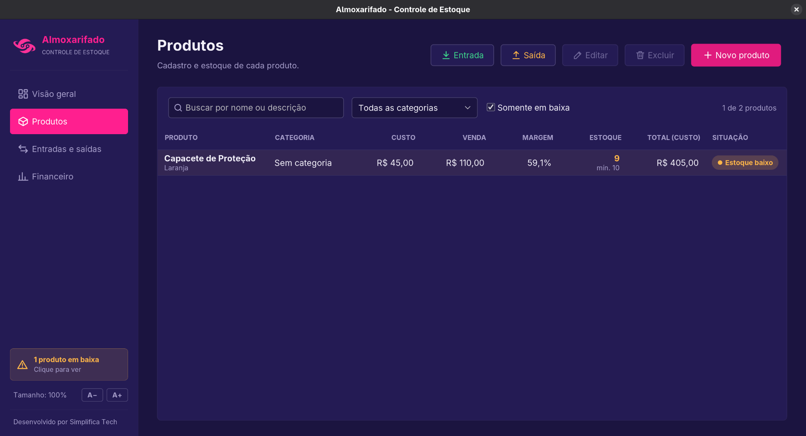
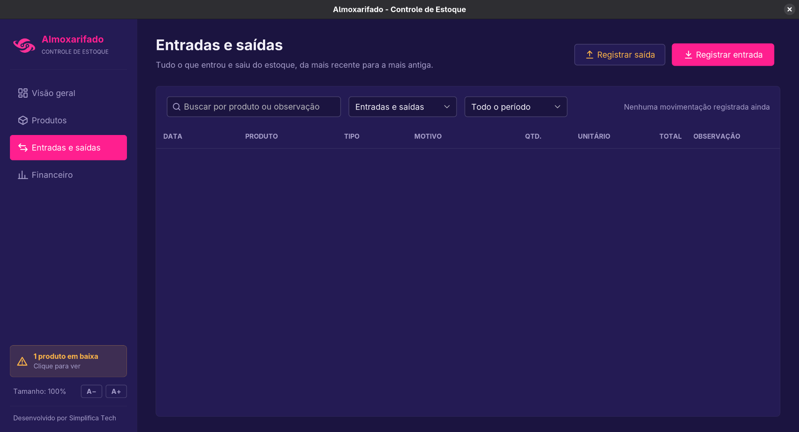
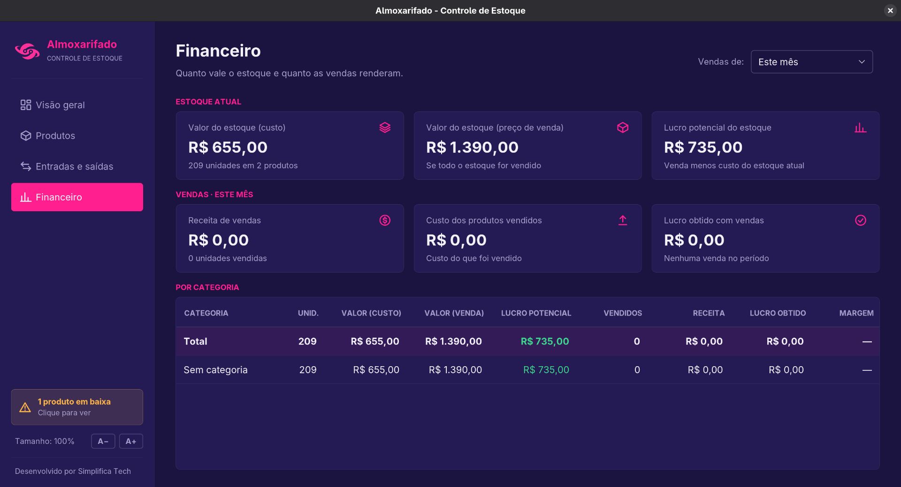

# Almoxarifado

Sistema desktop de controle de estoque desenvolvido em Java para praticar e aplicar conceitos de programação orientada a objetos, banco de dados, persistência de dados e desenvolvimento de interfaces gráficas.

O projeto começou como uma aplicação de console e foi evoluindo até possuir uma interface gráfica em Java Swing, com cadastro de produtos, registro de entradas e saídas e acompanhamento do valor do estoque e do lucro das vendas.


## Sobre o projeto

O sistema permite realizar as principais operações de um pequeno almoxarifado:

* Cadastro e edição de produtos, com categorias
* Registro de entradas e saídas de estoque, com motivo (compra, venda, uso interno, perda ou ajuste)
* Histórico de todas as movimentações, com busca e filtros por tipo e período
* Controle de estoque mínimo
* Identificação visual de produtos em baixa ou sem estoque
* Valor do estoque e lucro obtido com vendas, no total e por categoria
* Custo médio do produto recalculado a cada compra
* Interface que se ajusta à resolução da tela, com controle manual de tamanho
* Persistência dos dados em banco de dados

Cada produto possui informações como nome, categoria, descrição, preço de custo, preço de venda, quantidade disponível e estoque mínimo.

A quantidade de um produto só muda por entradas e saídas, para que o histórico sempre bata com o estoque. Ao excluir um produto, as vendas já registradas continuam no financeiro.

## Telas

### Produtos

Lista com busca, filtro por categoria e opção de mostrar somente os produtos em baixa.



### Entradas e saídas

Histórico de tudo o que entrou e saiu do estoque.



### Financeiro

Valor do estoque a preço de custo e de venda, e o resultado das vendas no período escolhido.



## Tecnologias utilizadas

* Java 25
* Java Swing com FlatLaf
* Maven
* JDBC
* SQLite
* PostgreSQL
* JUnit e Mockito
* jpackage e Launch4j
* Git e GitHub

## Estrutura

O projeto foi organizado separando as principais responsabilidades da aplicação:

```text
packaging/                  script e ícones para gerar os pacotes
src/
├── main/
│   ├── java/
│   │   └── com/
│   │       └── almoxarifado/
│   │           ├── database/
│   │           │   ├── postgres/
│   │           │   └── sqlite/
│   │           ├── model/
│   │           ├── service/
│   │           └── ui/
│   └── resources/          ícones e imagens da interface
│
└── test/
    └── java/
        └── com/
            └── almoxarifado/
```

A camada `model` contém as entidades do sistema, `service` concentra as regras de negócio e os cálculos do financeiro, `database` cuida da comunicação com o banco e `ui` contém as telas e os formulários.

## Banco de dados

O projeto possui suporte para SQLite e PostgreSQL.

A versão padrão utiliza SQLite, sem a necessidade de instalar um servidor de banco de dados. O arquivo fica em `.almoxarifado/almoxarifado.db`, dentro da pasta do usuário, e é criado na primeira execução.

Bancos criados por versões anteriores são atualizados automaticamente ao abrir o programa, sem perda de dados.

Na versão PostgreSQL, as informações de conexão são obtidas através de variáveis de ambiente:

```text
DB_URL
DB_USER
DB_PASSWORD
```

A senha não fica armazenada diretamente no código.

## Executando o projeto

Clone o repositório:

```bash
git clone https://github.com/fesqueira/almoxarifado.git
```

Entre na pasta:

```bash
cd almoxarifado
```

Compile o projeto utilizando Maven:

```bash
./mvnw clean package
```

No Linux, caso seja necessário dar permissão ao Maven Wrapper:

```bash
chmod +x mvnw
```

Depois execute a aplicação (é necessário ter o Java 25 instalado):

```bash
java -jar target/almoxarifado.jar
```

Para usar um banco de testes em vez do banco padrão:

```bash
java -Dalmoxarifado.db.path=/tmp/teste.db -jar target/almoxarifado.jar
```

## Gerando os pacotes para entrega

Para que o programa rode em máquinas sem Java instalado, o script abaixo gera pacotes com o Java embutido:

```bash
packaging/build-dist.sh
```

Ele precisa ser executado no Linux, com JDK 25, `curl`, `zip` e `unzip`, e cria na pasta `dist/`:

| Arquivo | Uso |
| --- | --- |
| `Almoxarifado-<versão>-windows-x64.zip` | Windows: descompactar e abrir `Almoxarifado.exe` |
| `Almoxarifado-<versão>-linux-x64.tar.gz` | Linux: descompactar e executar `Almoxarifado/bin/Almoxarifado` |
| `almoxarifado-<versão>-1.x86_64.rpm` | Instalador para Fedora/RHEL, com atalho no menu |

Na primeira execução o script baixa o Java (Eclipse Temurin) para cada sistema e confere a integridade dos arquivos.

## Testes

O projeto possui testes utilizando JUnit e Mockito para as regras de negócio, os cálculos do financeiro e o acesso ao banco SQLite.

Para executar os testes:

```bash
./mvnw test
```

## Objetivo

Esse projeto foi desenvolvido principalmente como forma de aprendizado e prática de Java, buscando aplicar conceitos que vão além de exercícios simples, como:

* Programação Orientada a Objetos
* Separação de responsabilidades
* Padrão de acesso a dados
* JDBC
* Persistência de informações
* Tratamento de exceções
* Testes automatizados
* Desenvolvimento de interfaces gráficas
* Integração com banco de dados
* Organização de um projeto Maven
* Empacotamento e distribuição de uma aplicação desktop

O projeto continua podendo receber melhorias e novas funcionalidades conforme meu aprendizado em Java evolui.

## Autor

**Felipe Siqueira**

Projeto desenvolvido para estudos e prática de desenvolvimento de software com Java.
